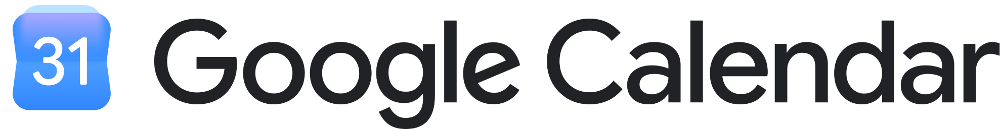

# ha-countdown-card

  &nbsp;&nbsp;
  &nbsp;&nbsp;
  

A Lovelace card that **counts down** to birthdays, holidays and trips: the days left, the age reached and an illustration for each kind of event.

> [!NOTE]
> This card is being designed: there is no release yet. Watch the repository to know when the first version is out.

| Card | Type | What it shows |
|---|---|---|
| Countdown | `custom:countdown-card` | The next birthdays, holidays and trips, with the days left, the age reached and an illustration for each kind. |
| Countdown mini | `custom:countdown-mini-card` | The next event and its days left on two lines, with a zoom to the full card. |

## Supported integrations

The card reads the events of any calendar, date helpers and date sensors. Among them:

| | Integration | What the cards show |
|:---:|---|---|
|  | [Local Calendar](https://www.home-assistant.io/integrations/local_calendar/) (built in) | Events stored in Home Assistant |
|  | [Google Calendar](https://www.home-assistant.io/integrations/google/) (built in) | Google calendars |
|  | [CalDAV](https://www.home-assistant.io/integrations/caldav/) (built in) | iCloud, Nextcloud and other CalDAV calendars |
|  | [Anniversaries](https://github.com/pinkywafer/Anniversaries) (Marketplace) | Birthdays and anniversaries with the years |
|  | [Date helpers](https://www.home-assistant.io/integrations/input_datetime/) (built in) | `input_datetime` helpers and `timestamp` sensors |

## Installation

### Via the Marketplace (recommended)

Click the button below to add the repository directly:

Or manually:

1. Open **Settings → Marketplace → Add from link** (top right; this needs a GitHub account connected)
2. Add `https://github.com/juju35/ha-countdown-card` — Type: **Dashboard**
3. Open **Countdown Card** and click **Install**
4. Clear your browser cache and refresh

The Marketplace registers the dashboard resource for you.

### Manual

1. Download `ha-countdown-card.js` and the `ha-countdown-card.i18n.*.js` translation files from the [latest release](https://github.com/juju35/ha-countdown-card/releases/latest)
2. Copy them all to `/config/www/` (without the translation files, the cards show in English)
3. Go to **Settings → Dashboards → Resources** → Add resource:
   - URL: `/local/ha-countdown-card.js`
   - Type: **JavaScript Module**
4. Clear your browser cache and refresh

## License

[MIT](https://github.com/juju35/ha-countdown-card/blob/main/LICENSE)

## Support

If you find this project useful, you can support its development:

