# ha-countdown-card

[](https://www.home-assistant.io/integrations/marketplace/)
[](https://github.com/juju35/ha-countdown-card/actions/workflows/hacs.yml)
[](https://github.com/juju35/ha-countdown-card/actions/workflows/validate.yml)
[](https://github.com/juju35/ha-countdown-card/actions/workflows/lint.yml)
[](https://github.com/juju35/ha-countdown-card/releases/latest)
[](https://github.com/juju35/ha-countdown-card/blob/main/LICENSE)
[](https://buymeacoffee.com/julienstep9)

<p align="center"></p>

<p align="center">
  &nbsp;&nbsp;
  &nbsp;&nbsp;
  
</p>

A Lovelace card that **counts down** to birthdays, holidays and trips: the days left, the age reached and an illustration for each kind of event.

[](https://my.home-assistant.io/redirect/marketplace_repository/?owner=juju35&repository=ha-countdown-card&category=plugin)

| Card | Type | What it shows |
|---|---|---|
| [Countdown](#screenshots) | `custom:countdown-card` | The next birthdays, holidays and trips, with the days left, the age reached and an illustration for each kind. |
| [Countdown mini](#countdown-mini) | `custom:countdown-mini-card` | The next event and its days left on two lines, with a zoom to the full card. |

| In 3 days | Today |
|---|---|
| 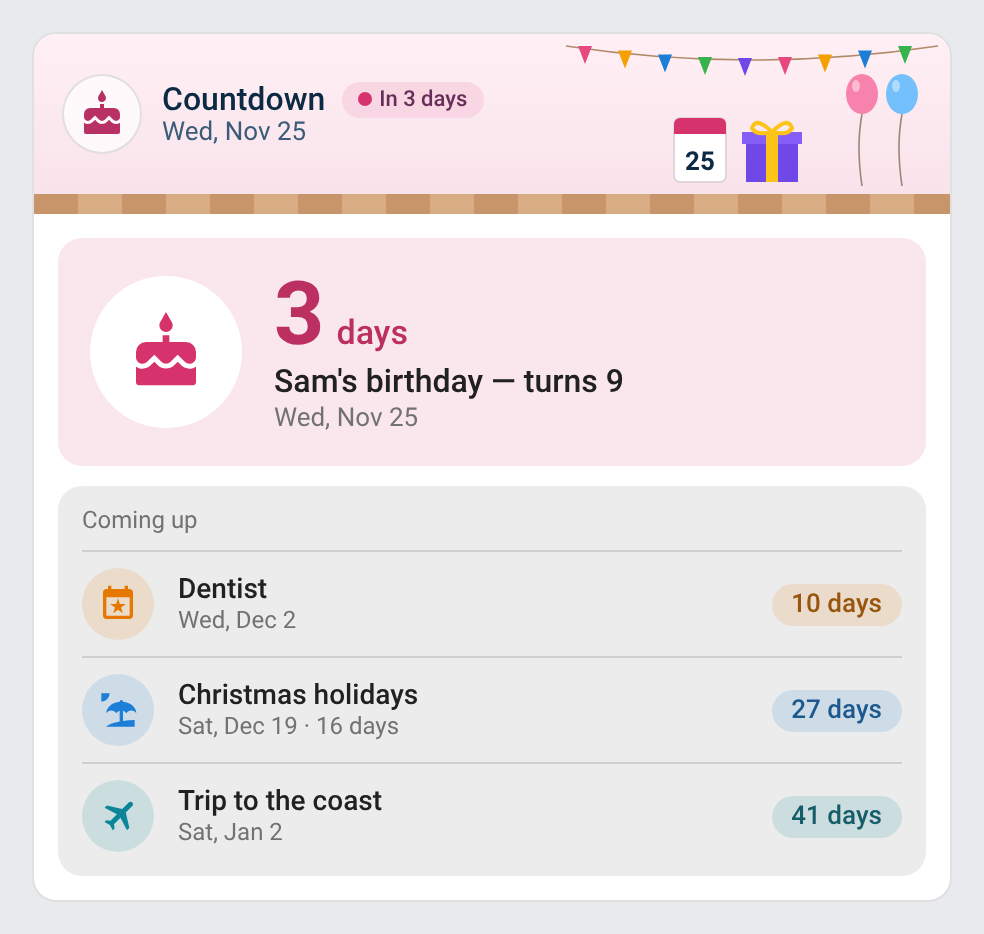 | 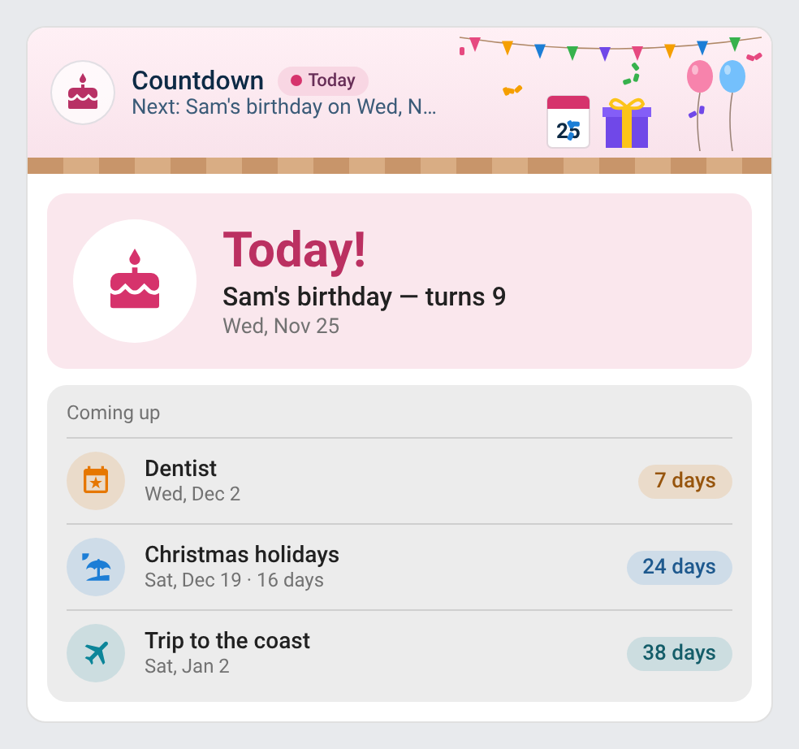 |

## Features

- **The next event in big**: its picture by type (a cake, a beach, a plane, a present), the days left, its name with the age reached or the years, and its date (with its last day for an event of several days)
- **Coming up**: the next ones with their date, the age, the years or how many days they last, and a pill with the days left
- **Every kind of source**: calendars, Anniversaries sensors, date helpers, timestamp sensors, and a list of events in the card's config (yearly or not)
- **Types found in the name** when not given — *birthday*, *holiday*, *trip*, *anniversary* — in the 22 languages of the card (*anniversaire de mariage* is a wedding anniversary, *anniversaire* a birthday)
- **Illustrated header**: bunting, a calendar page showing the next event's day, a present and two balloons that sway; confetti fall on the day itself; the dark theme darkens the room
- **Mini card**: when, the event's name and the age reached as chips, and its calendar page with the month in the event's colour; its zoom button opens the full card in place
- **Tap an event** from an entity to open its details
- Visual editor for both cards, light and dark themes, 22 languages, no external dependency

## Supported integrations

The card reads the events of any calendar, date helpers and date sensors. Among them:

| | Integration | What the cards show |
|:---:|---|---|
|  | [Local Calendar](https://www.home-assistant.io/integrations/local_calendar/) (built in) | Events stored in Home Assistant |
|  | [Google Calendar](https://www.home-assistant.io/integrations/google/) (built in) | Google calendars |
|  | [CalDAV](https://www.home-assistant.io/integrations/caldav/) (built in) | iCloud, Nextcloud and other CalDAV calendars |
|  | [Anniversaries](https://github.com/pinkywafer/Anniversaries) (Marketplace) | Birthdays and anniversaries with the years |
|  | [Date helpers](https://www.home-assistant.io/integrations/input_datetime/) (built in) | `input_datetime` helpers and `timestamp` sensors |

## Installation

### Via the Marketplace (recommended)

Click the button below to add the repository directly:

[](https://my.home-assistant.io/redirect/marketplace_repository/?owner=juju35&repository=ha-countdown-card&category=plugin)

Or manually:

1. Open **Settings → Marketplace → Add from link** (top right; this needs a GitHub account connected)
2. Add `https://github.com/juju35/ha-countdown-card` — Type: **Dashboard**
3. Open **Countdown Card** and click **Install**
4. Clear your browser cache and refresh

The Marketplace registers the dashboard resource for you.

### Manual

1. Download `ha-countdown-card.js` and the `ha-countdown-card.i18n.*.js` translation files from the [latest release](https://github.com/juju35/ha-countdown-card/releases/latest)
2. Copy them all to `/config/www/` (without the translation files, the cards show in English)
3. Go to **Settings → Dashboards → Resources** → Add resource:
   - URL: `/local/ha-countdown-card.js`
   - Type: **JavaScript Module**
4. Clear your browser cache and refresh

## Configuration

Every option but `events` is in the visual editor. In YAML:

```yaml
type: custom:countdown-card
calendars:
  - calendar.family
entities:
  - sensor.sam_birthday
  - input_datetime.trip

# Events written in the card: a date with its year (yearly for a birthday or an anniversary), or MM-DD for every year
type: custom:countdown-card
events:
  - name: Sam's birthday
    date: 2017-11-25
  - name: Wedding anniversary
    date: 2014-01-19
  - name: Trip to the coast
    date: 2027-01-02
    end: 2027-01-05
    type: trip
  - name: New Year's Eve
    date: 12-31
    type: event

# Two lines on a phone dashboard
type: custom:countdown-mini-card
calendars:
  - calendar.family
```

| Option | Type | Default | Description |
|---|---|---|---|
| `title` | string | `Countdown` | Both: card title |
| `show_title` | boolean | `true` | Both: show the title |
| `show_subtitle` | boolean | `true` | The next event's date under the title |
| `navigation_path` | string | | Both: a tap on the header opens this dashboard path |
| `calendars` | list | | Both: calendars whose events over the next `days_ahead` days are counted down |
| `entities` | list | the Anniversaries sensors, when nothing else is set | Both: date helpers, `timestamp` sensors, Anniversaries sensors |
| `events` | list | | Both, YAML only: events written in the card — `name`, `date` (`YYYY-MM-DD` or `MM-DD`), `type` (`birthday`, `holiday`, `trip`, `anniversary`, `event`; else found in the name), `yearly` (default: a birthday, an anniversary or a date without a year), `end` (the last day), `icon` |
| `days_ahead` | number | `365` | Both: how far to look for events |
| `max_items` | number | `4` | Both: the next event and those coming up |
| `illustration` | boolean | `true` | Both: the illustrated header (`false`: the classic header) |
| `illustration_theme` | string | `auto` | Both: `auto` (follows the Home Assistant theme: night with a dark theme, day with a light theme), `day` or `night` |
| `animations` | boolean | `true` | Both: the balloons and the confetti |
| `zoom` | boolean | `true` | Mini card: the zoom button |
| `language` | string | Home Assistant's | Advanced: one of the [languages](#translations) |

## Screenshots

| In 3 days | Today | Later |
|---|---|---|
|  |  | 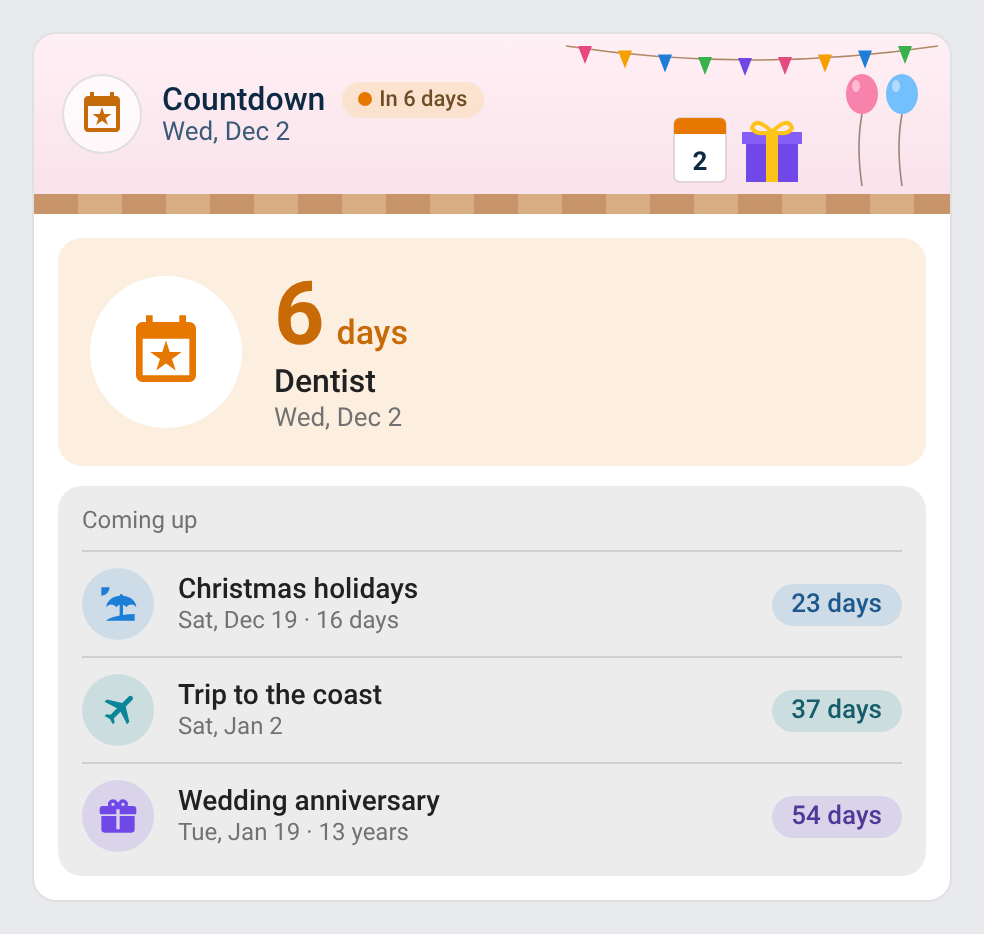 |
| 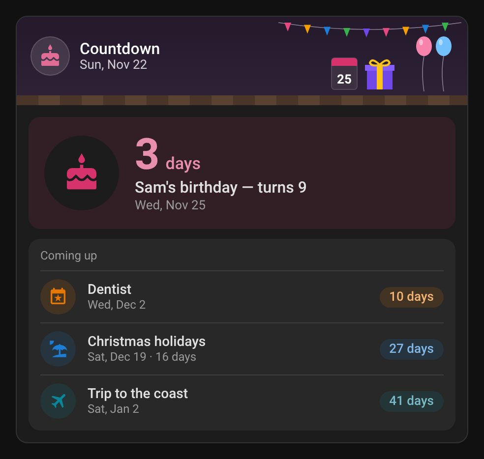 | 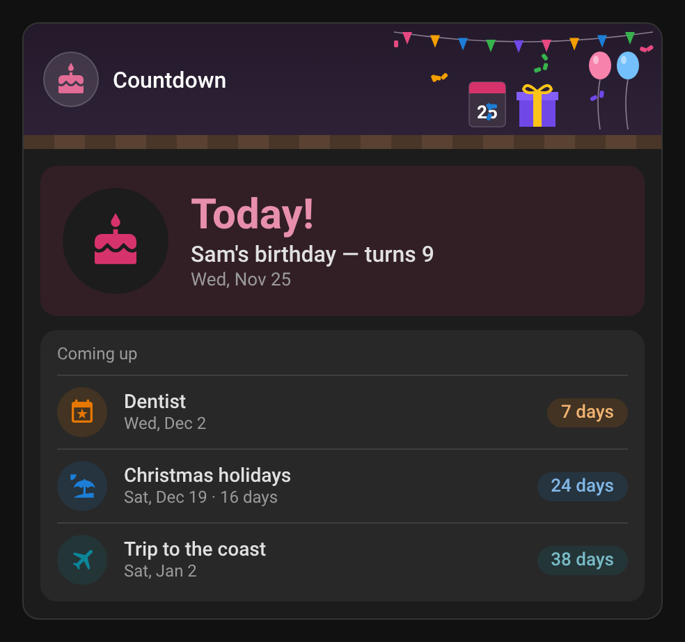 | 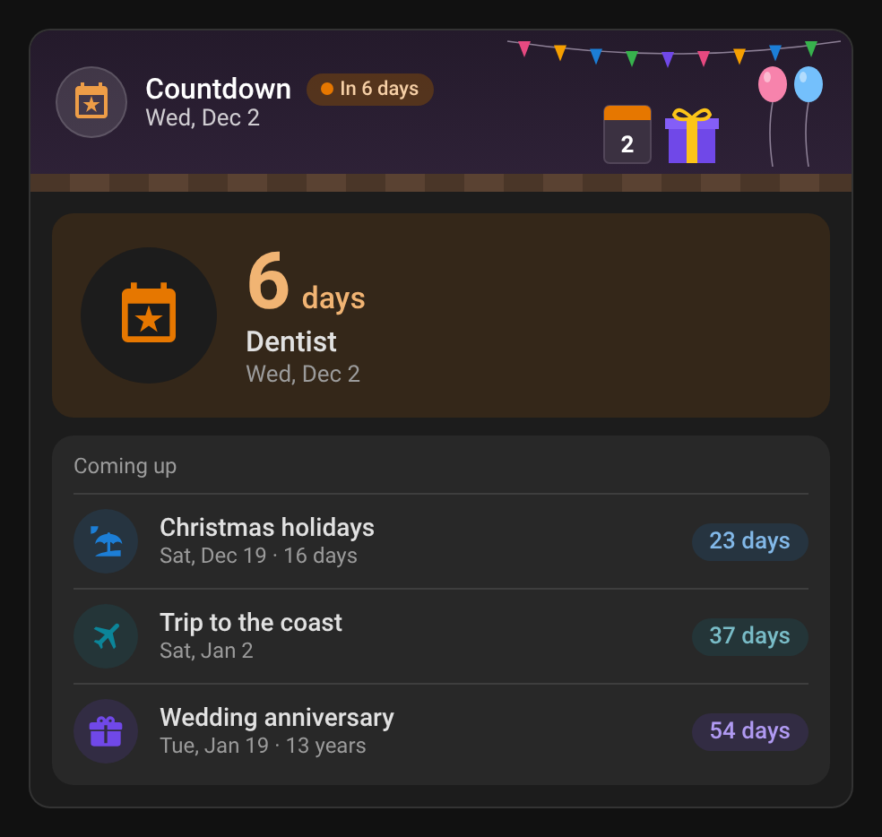 |

| Nothing coming up | Narrow |
|---|---|
| 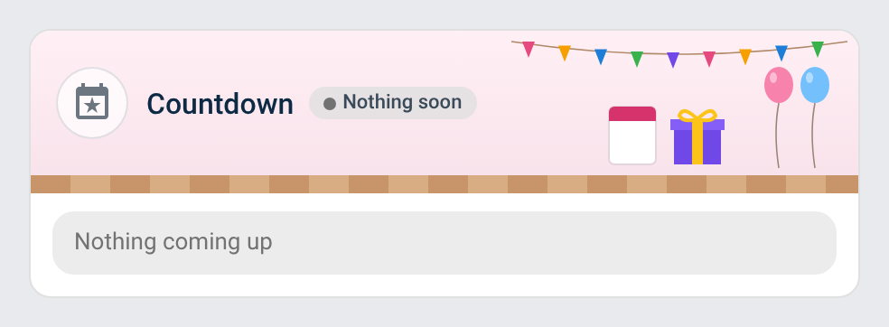 | 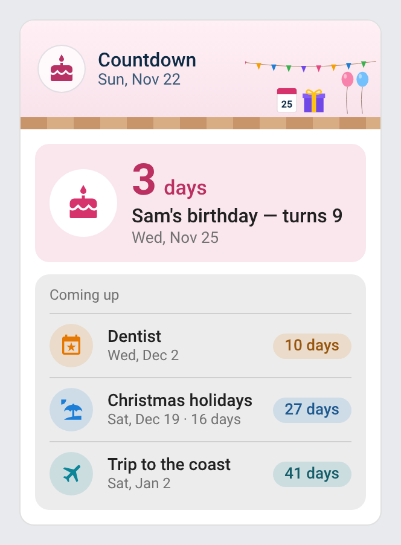 |
| 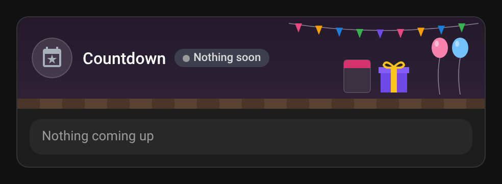 | 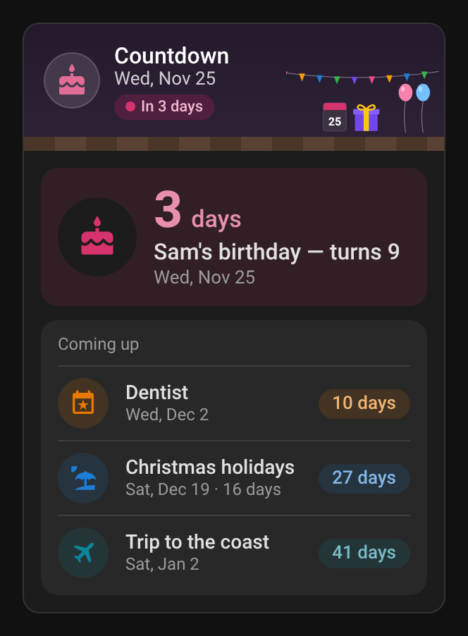 |

**Balloons animation**: the balloons sway every day (still with `animations: false`, or when the system asks for reduced motion).

| Light | Dark |
|---|---|
| 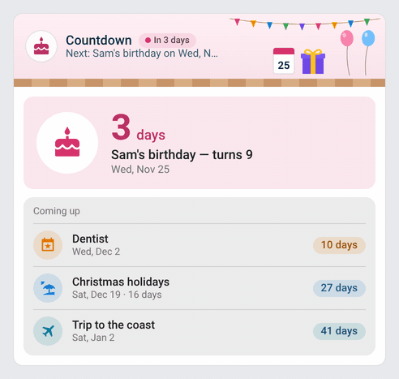 | 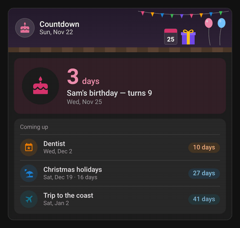 |

**Confetti animation**: on the day itself, confetti fall over the party.

| Light | Dark |
|---|---|
| 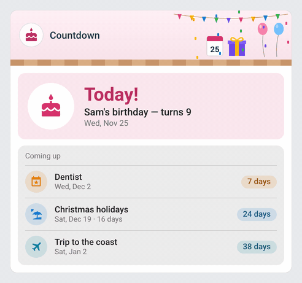 | 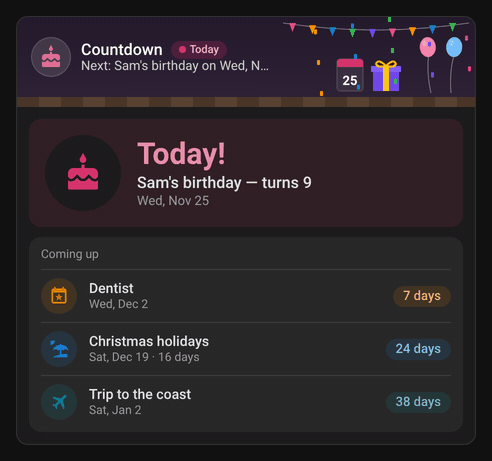 |

### Countdown mini

| In 3 days | Today | Zoomed in |
|---|---|---|
| 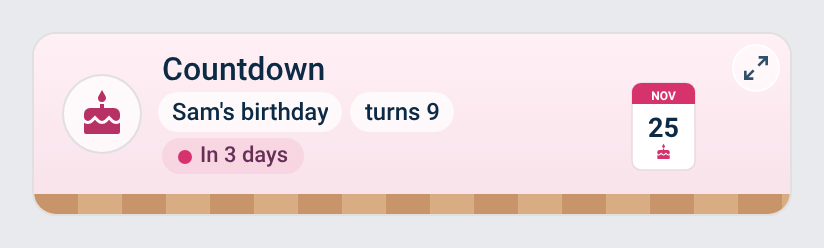 | 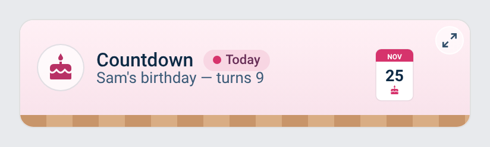 | 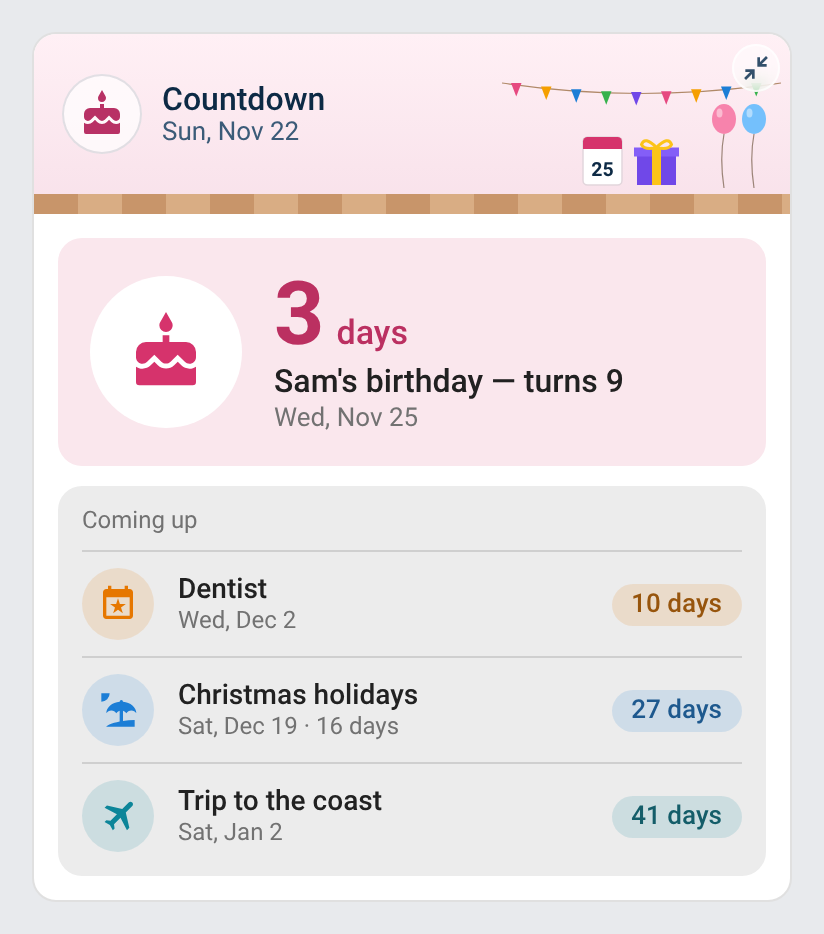 |
| 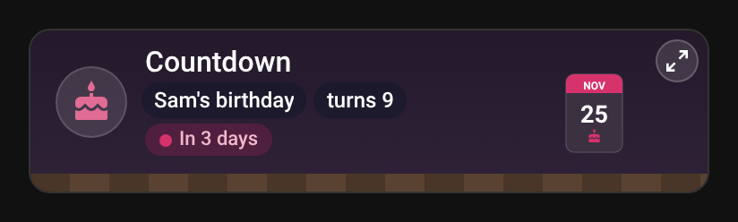 | 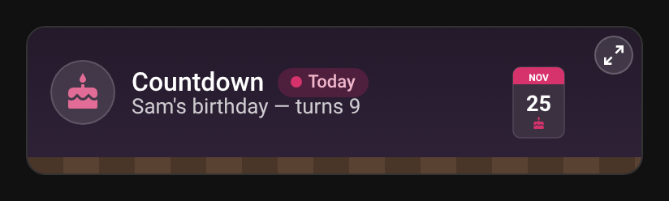 | 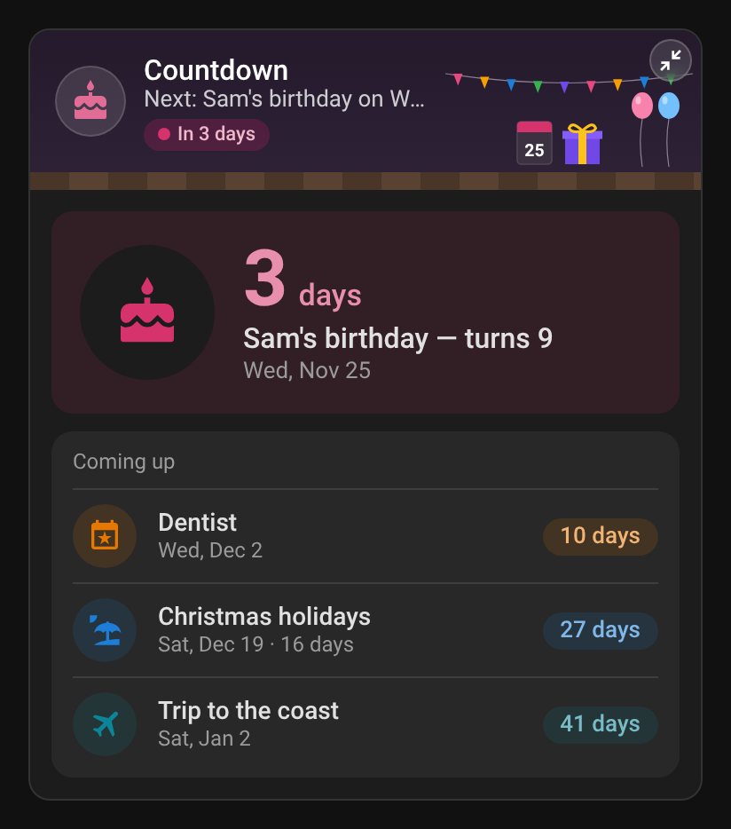 |

## How it works

- **Calendars**: their events from today to `days_ahead` days ahead, through Home Assistant's calendar API, fetched at first, every 30 minutes and at each new day; an all-day event's end is the day before its end date, and an event of several days that has started counts as today
- **Anniversaries**: the sensor's `next_date` (else its `date` this year or next) and `years_at_next_anniversary`
- **Date helpers and `timestamp` sensors**: their date; a birthday or an anniversary (by its name) comes back every year with the years since its first year
- **`events`**: as written; yearly by default for a birthday, an anniversary or a date without a year
- **Type**: `type` when given, else the name: a wedding first, then *anniversary*, *birthday*, *holiday*, *trip* in the 22 languages, else *event*
- **Days**: whole days between local midnights (a daylight saving change never counts)
- **Read only**: the card calls no action

## Development

```bash
npm install
npm run build        # stamps the version of package.json into dist/ha-countdown-card.js
npm run check        # builds and checks the bundle (run in CI)
npm test             # unit tests
npm run screenshots  # renders the cards with mock events into screenshots/ (and the GIFs, needs ffmpeg)
```

`dist/` is not committed: `npm run build` creates it locally, CI builds it on every push, and the release workflow attaches the built files to the release, which is where the Marketplace installs them from.

### Releasing

1. Bump `version` in `package.json`
2. Add a `## <version>` section at the top of [CHANGELOG.md](https://github.com/juju35/ha-countdown-card/blob/main/CHANGELOG.md)
3. Push to `main`: the **Release** workflow builds the card, creates the tag and the GitHub release with the changelog section as notes, and attaches `ha-countdown-card.js` and its translation files

## Translations

The card auto-detects the language from your Home Assistant settings. Currently supported:

| Language | Code |
|---|---|
| English | `en` |
| Français | `fr` |
| Deutsch | `de` |
| Español | `es` |
| Српски | `sr` |
| Srpski (latinica) | `sr-Latn` |
| Italiano | `it` |
| Nederlands | `nl` |
| Português (Portugal) | `pt` |
| Polski | `pl` |
| Română | `ro` |
| Dansk | `da` |
| Svenska | `sv` |
| Български | `bg` |
| Русский | `ru` |
| Українська | `uk` |
| Magyar | `hu` |
| Slovenčina | `sk` |
| Čeština | `cs` |
| Slovenščina | `sl` |
| Latviešu | `lv` |
| Ελληνικά | `el` |

Contributions for additional languages are welcome!

## License

[MIT](https://github.com/juju35/ha-countdown-card/blob/main/LICENSE)

## Support

If you find this project useful, you can support its development:

<a href="https://buymeacoffee.com/julienstep9"></a>
